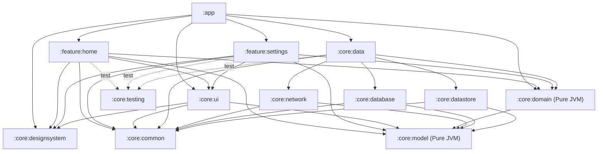
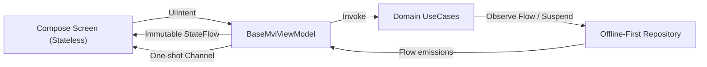

# KuchBhi — Enterprise Android Application

An enterprise-grade Android application built with **Kotlin**, **Jetpack Compose**, **MVI (Unidirectional Data Flow)**, and a **Now in Android–style Feature + Core multi-module architecture** targeting **Android 15 (API 35+)**.

> **For AI Coding Agents & Automated Environment Setup:**  
> This `README.md` is designed to be **fully self-contained and machine-actionable**. Follow the [Complete System Setup Guide](#complete-system-setup-guide-ai--developer-onboarding) below in exact order to install every required tool, configure environment variables, bootstrap Gradle, and verify a passing build on **Linux**, **macOS**, or **Windows** — including headless/CLI-only environments.

---

## Table of Contents

1. [Project Metadata & Toolchain Matrix](#project-metadata--toolchain-matrix)
2. [Key Architectural Highlights](#key-architectural-highlights)
3. [Complete System Setup Guide (AI & Developer Onboarding)](#complete-system-setup-guide-ai--developer-onboarding)
   - [Step 0: Preflight Environment Check](#step-0-preflight-environment-check)
   - [Step 1: Install Git & GitHub CLI](#step-1-install-git--github-cli)
   - [Step 2: Install JDK 17 (Eclipse Temurin) & Set `JAVA_HOME`](#step-2-install-jdk-17-eclipse-temurin--set-java_home)
   - [Step 3: Install Gradle 8.10.2](#step-3-install-gradle-8102)
   - [Step 4: Install Android SDK Command-Line Tools & API 35 Packages](#step-4-install-android-sdk-command-line-tools--api-35-packages)
   - [Step 5: Install Android Emulator & API 35 AVD (Optional — UI Tests)](#step-5-install-android-emulator--api-35-avd-optional--ui-tests)
   - [Step 6: Install Android Studio (Optional — Human GUI Development)](#step-6-install-android-studio-optional--human-gui-development)
   - [Step 7: Clone Repository, Create `local.properties` & Bootstrap Wrapper](#step-7-clone-repository-create-localproperties--bootstrap-wrapper)
   - [Step 8: End-to-End Verification Checklist (Pass/Fail Gate)](#step-8-end-to-end-verification-checklist-passfail-gate)
   - [Troubleshooting Common Setup Issues](#troubleshooting-common-setup-issues)
4. [Module Dependency Graph](#module-dependency-graph)
5. [MVI Unidirectional Data Flow](#mvi-unidirectional-data-flow)
6. [Repository Folder Structure](#repository-folder-structure)
7. [Build Flavors & Environments](#build-flavors--environments)
8. [Common Gradle Commands](#common-gradle-commands)
9. [AI Agent Development Playbook & Architectural Rules](#ai-agent-development-playbook--architectural-rules)
10. [Documentation & ADRs](#documentation--adrs)
11. [License](#license)

---

## Project Metadata & Toolchain Matrix

| Component | Required Version / Value | Notes |
| --- | --- | --- |
| **Project Name** | `KuchBhi` | Root project in `settings.gradle.kts` |
| **Application ID / Base Package** | `com.kuchBhi.com` | Honor exact casing across modules |
| **Min / Target / Compile SDK** | `35` / `35` / `35` | Android 15+ (`platforms;android-35`) |
| **Android Build Tools** | `35.0.0` | `build-tools;35.0.0` |
| **JDK** | **JDK 17** (LTS, Eclipse Temurin) | Required by AGP 8.7.2 & Gradle 8.10.2; do **not** use JDK 23+ |
| **Gradle** | `8.10.2` | Configured in `gradle/wrapper/gradle-wrapper.properties` |
| **Android Gradle Plugin (AGP)** | `8.7.2` | Declared in `gradle/libs.versions.toml` |
| **Kotlin / KSP** | `2.0.21` / `2.0.21-1.0.28` | Compose Compiler Gradle Plugin enabled |
| **UI & Presentation** | Jetpack Compose (Material 3) + MVI | BOM `2024.10.01`, Type-Safe Navigation `2.8.4` |
| **DI & Async** | Hilt `2.52` + Coroutines `1.9.0` | Compile-time DI via KSP |
| **Networking & Storage** | Retrofit `2.11.0`, OkHttp `4.12.0`, Room `2.6.1`, DataStore `1.1.1`, Kotlinx Serialization `1.7.3` | Offline-first SSOT |
| **Static Analysis** | `ktlint` (`12.1.2`), `Detekt` (`1.23.7`), Android Lint | Enforced in GitHub Actions CI |
| **Disk & RAM Minimum** | `>= 10 GB` free disk, `>= 8 GB` RAM (`16 GB` recommended) | Gradle JVM uses `-Xmx4096m` |

---

## Key Architectural Highlights

- **Multi-Module Architecture (`:app`, `:core:*`, `:feature:*`, `:build-logic`)**: Strictly enforced dependency boundaries for parallel Gradle builds, clear team ownership, and zero circular dependencies.
- **Jetpack Compose + MVI (UDF)**: Immutable `UiState`, explicit `UiIntent` actions, and lifecycle-safe one-shot `UiEffect` events via `BaseMviViewModel`.
- **Offline-First Single Source of Truth**: Room database + Preferences DataStore drive the UI reactively via Kotlin `Flow`; Retrofit/OkHttp + Kotlinx Serialization synchronize remote data into local storage.
- **Enterprise Build System**: Centralized Gradle Version Catalog (`gradle/libs.versions.toml`) + reusable Kotlin DSL convention plugins (`build-logic`).
- **Multi-Environment Flavors**: `dev`, `staging`, and `prod` flavors with isolated Application IDs, environment-specific API endpoints, network security configs, and R8/ProGuard optimization.
- **Quality Gates & CI/CD**: Automated `ktlint`, `Detekt`, Android Lint, JVM/Android unit tests, and APK/AAB builds via GitHub Actions.

---

## Complete System Setup Guide (AI & Developer Onboarding)

Execute Steps **0 through 8** sequentially. Skip an installation step **only** if Step 0 confirms the exact required version is already installed and on `PATH`.

### Step 0: Preflight Environment Check

Run the snippet for your OS to inspect what is already installed:

<details open>
<summary><strong>Linux / macOS (bash/zsh)</strong></summary>

```bash
echo "OS: $(uname -s) $(uname -m)"
git --version || echo "MISSING: git"
java -version 2>&1 || echo "MISSING: java (need JDK 17)"
echo "JAVA_HOME=${JAVA_HOME:-UNSET}"
gradle -v 2>&1 | head -n 5 || echo "MISSING: gradle (need 8.10.2)"
echo "ANDROID_HOME=${ANDROID_HOME:-UNSET}"
command -v sdkmanager || echo "MISSING: sdkmanager"
command -v adb || echo "MISSING: adb"
```
</details>

<details>
<summary><strong>Windows (PowerShell)</strong></summary>

```powershell
git --version
java -version
Write-Output "JAVA_HOME=$env:JAVA_HOME"
gradle -v
Write-Output "ANDROID_HOME=$env:ANDROID_HOME"
Get-Command sdkmanager -ErrorAction SilentlyContinue
Get-Command adb -ErrorAction SilentlyContinue
```
</details>

---

### Step 1: Install Git & GitHub CLI

#### Linux (Ubuntu / Debian)
```bash
sudo apt-get update
sudo apt-get install -y git curl unzip zip ca-certificates

# Optional: GitHub CLI (gh)
sudo apt-get install -y gh || true
```

#### macOS (Homebrew)
```bash
# Install Homebrew if missing:
# /bin/bash -c "$(curl -fsSL https://raw.githubusercontent.com/Homebrew/install/HEAD/install.sh)"
brew install git gh
```

#### Windows (PowerShell via `winget`)
```powershell
winget install --id Git.Git -e --source winget --accept-package-agreements --accept-source-agreements
winget install --id GitHub.cli -e --source winget --accept-package-agreements --accept-source-agreements
```
> Restart your terminal (or refresh `$env:Path`) after `winget` installations on Windows.

**Verify:**
```bash
git --version   # Expected: git version 2.40+
```

---

### Step 2: Install JDK 17 (Eclipse Temurin) & Set `JAVA_HOME`

> **Important:** AGP `8.7.2` and Gradle `8.10.2` require **JDK 17** (LTS). Do not default to JDK 11 or JDK 23+.

#### Linux (Ubuntu / Debian)
```bash
sudo apt-get update
sudo apt-get install -y openjdk-17-jdk

# Set JAVA_HOME persistently
export JAVA_HOME="$(dirname $(dirname $(readlink -f $(which javac))))"
echo "export JAVA_HOME=\"$JAVA_HOME\"" >> ~/.bashrc
echo 'export PATH="$JAVA_HOME/bin:$PATH"' >> ~/.bashrc
```

#### macOS (Homebrew)
```bash
brew install --cask temurin@17

# Set JAVA_HOME persistently (zsh)
export JAVA_HOME="$(/usr/libexec/java_home -v 17)"
echo 'export JAVA_HOME="$(/usr/libexec/java_home -v 17)"' >> ~/.zshrc
echo 'export PATH="$JAVA_HOME/bin:$PATH"' >> ~/.zshrc
```

#### Windows (PowerShell via `winget`)
```powershell
winget install --id EclipseAdoptium.Temurin.17.JDK -e --source winget --accept-package-agreements --accept-source-agreements

# Locate installed JDK 17 directory and set JAVA_HOME persistently
$jdkDir = (Get-ChildItem "C:\Program Files\Eclipse Adoptium\jdk-17*" -Directory | Sort-Object Name -Descending | Select-Object -First 1).FullName
[Environment]::SetEnvironmentVariable("JAVA_HOME", $jdkDir, "User")
$env:JAVA_HOME = $jdkDir
$env:Path = "$jdkDir\bin;$env:Path"
```

**Verify:**
```bash
java -version    # Expected: openjdk version "17.x.x"
javac -version   # Expected: javac 17.x.x
```

---

### Step 3: Install Gradle 8.10.2

Gradle `8.10.2` is used to bootstrap the local Gradle wrapper (`./gradlew` / `gradlew.bat`) and can also invoke tasks directly.

#### Linux / macOS (Direct Official Zip — Deterministic Version `8.10.2`)
```bash
GRADLE_VERSION="8.10.2"
mkdir -p "$HOME/.local/opt"
curl -fsSL "https://services.gradle.org/distributions/gradle-${GRADLE_VERSION}-bin.zip" -o /tmp/gradle.zip
unzip -qo /tmp/gradle.zip -d "$HOME/.local/opt"
rm -f /tmp/gradle.zip

export GRADLE_HOME="$HOME/.local/opt/gradle-${GRADLE_VERSION}"
export PATH="$GRADLE_HOME/bin:$PATH"

# Persist for future shells (~/.bashrc on Linux, ~/.zshrc on macOS)
SHELL_RC="$HOME/.bashrc"
[ "$(uname -s)" = "Darwin" ] && SHELL_RC="$HOME/.zshrc"
echo "export GRADLE_HOME=\"$GRADLE_HOME\"" >> "$SHELL_RC"
echo 'export PATH="$GRADLE_HOME/bin:$PATH"' >> "$SHELL_RC"
```

#### Windows (PowerShell — Direct Official Zip)
```powershell
$gradleVersion = "8.10.2"
$gradleRoot = "$env:LOCALAPPDATA\Gradle"
$zipPath = "$env:TEMP\gradle-$gradleVersion-bin.zip"
New-Item -ItemType Directory -Force -Path $gradleRoot | Out-Null
Invoke-WebRequest -Uri "https://services.gradle.org/distributions/gradle-$gradleVersion-bin.zip" -OutFile $zipPath
Expand-Archive -Path $zipPath -DestinationPath $gradleRoot -Force
Remove-Item $zipPath -Force

$gradleBin = "$gradleRoot\gradle-$gradleVersion\bin"
$userPath = [Environment]::GetEnvironmentVariable("Path", "User")
if ($userPath -notlike "*$gradleBin*") {
    [Environment]::SetEnvironmentVariable("Path", "$userPath;$gradleBin", "User")
}
$env:Path = "$gradleBin;$env:Path"
```

**Verify:**
```bash
gradle -v   # Expected: Gradle 8.10.2 (running on JVM 17)
```

---

### Step 4: Install Android SDK Command-Line Tools & API 35 Packages

This works completely **headlessly** (no GUI / Android Studio required), making it ideal for AI agents, containers, and CI environments.

> **Critical Directory Layout Requirement:**  
> `sdkmanager` **requires** the command-line tools to live strictly at:
> `$ANDROID_HOME/cmdline-tools/latest/bin/sdkmanager`  
> The official zip extracts a folder named `cmdline-tools/`; you **must** move its contents into `cmdline-tools/latest/`.

#### Linux (Headless / CLI)
```bash
export ANDROID_HOME="$HOME/Android/Sdk"
export ANDROID_SDK_ROOT="$ANDROID_HOME"
mkdir -p "$ANDROID_HOME/cmdline-tools"

curl -fsSL "https://dl.google.com/android/repository/commandlinetools-linux-11076708_latest.zip" -o /tmp/cmdline-tools.zip
unzip -qo /tmp/cmdline-tools.zip -d /tmp/android-cmdline
rm -rf "$ANDROID_HOME/cmdline-tools/latest"
mv /tmp/android-cmdline/cmdline-tools "$ANDROID_HOME/cmdline-tools/latest"
rm -rf /tmp/cmdline-tools.zip /tmp/android-cmdline

export PATH="$ANDROID_HOME/cmdline-tools/latest/bin:$ANDROID_HOME/platform-tools:$ANDROID_HOME/emulator:$PATH"

# Persist environment variables
cat << 'EOF' >> ~/.bashrc
export ANDROID_HOME="$HOME/Android/Sdk"
export ANDROID_SDK_ROOT="$ANDROID_HOME"
export PATH="$ANDROID_HOME/cmdline-tools/latest/bin:$ANDROID_HOME/platform-tools:$ANDROID_HOME/emulator:$PATH"
EOF

# Accept all SDK licenses non-interactively
yes | sdkmanager --licenses

# Install required Android 15 (API 35) SDK packages
sdkmanager \
  "platform-tools" \
  "platforms;android-35" \
  "build-tools;35.0.0"
```

#### macOS (Apple Silicon & Intel)
```bash
export ANDROID_HOME="$HOME/Library/Android/sdk"
export ANDROID_SDK_ROOT="$ANDROID_HOME"
mkdir -p "$ANDROID_HOME/cmdline-tools"

curl -fsSL "https://dl.google.com/android/repository/commandlinetools-mac-11076708_latest.zip" -o /tmp/cmdline-tools.zip
unzip -qo /tmp/cmdline-tools.zip -d /tmp/android-cmdline
rm -rf "$ANDROID_HOME/cmdline-tools/latest"
mv /tmp/android-cmdline/cmdline-tools "$ANDROID_HOME/cmdline-tools/latest"
rm -rf /tmp/cmdline-tools.zip /tmp/android-cmdline

export PATH="$ANDROID_HOME/cmdline-tools/latest/bin:$ANDROID_HOME/platform-tools:$ANDROID_HOME/emulator:$PATH"

# Persist environment variables
cat << 'EOF' >> ~/.zshrc
export ANDROID_HOME="$HOME/Library/Android/sdk"
export ANDROID_SDK_ROOT="$ANDROID_HOME"
export PATH="$ANDROID_HOME/cmdline-tools/latest/bin:$ANDROID_HOME/platform-tools:$ANDROID_HOME/emulator:$PATH"
EOF

# Accept all SDK licenses non-interactively
yes | sdkmanager --licenses

# Install required Android 15 (API 35) SDK packages
sdkmanager \
  "platform-tools" \
  "platforms;android-35" \
  "build-tools;35.0.0"
```

#### Windows (PowerShell)
```powershell
$androidHome = "$env:LOCALAPPDATA\Android\Sdk"
$cmdlineRoot = "$androidHome\cmdline-tools"
$tempExtract = "$env:TEMP\android-cmdline"
$zipPath = "$env:TEMP\cmdline-tools-win.zip"

New-Item -ItemType Directory -Force -Path $cmdlineRoot | Out-Null
Invoke-WebRequest -Uri "https://dl.google.com/android/repository/commandlinetools-win-11076708_latest.zip" -OutFile $zipPath

if (Test-Path $tempExtract) { Remove-Item -Recurse -Force $tempExtract }
Expand-Archive -Path $zipPath -DestinationPath $tempExtract -Force

$latestDir = "$cmdlineRoot\latest"
if (Test-Path $latestDir) { Remove-Item -Recurse -Force $latestDir }
Move-Item -Path "$tempExtract\cmdline-tools" -Destination $latestDir
Remove-Item -Force $zipPath
Remove-Item -Recurse -Force $tempExtract

# Set ANDROID_HOME and PATH persistently
[Environment]::SetEnvironmentVariable("ANDROID_HOME", $androidHome, "User")
[Environment]::SetEnvironmentVariable("ANDROID_SDK_ROOT", $androidHome, "User")
$sdkPaths = "$androidHome\cmdline-tools\latest\bin;$androidHome\platform-tools;$androidHome\emulator"
$userPath = [Environment]::GetEnvironmentVariable("Path", "User")
if ($userPath -notlike "*cmdline-tools\latest\bin*") {
    [Environment]::SetEnvironmentVariable("Path", "$userPath;$sdkPaths", "User")
}
$env:ANDROID_HOME = $androidHome
$env:ANDROID_SDK_ROOT = $androidHome
$env:Path = "$sdkPaths;$env:Path"

# Accept all SDK licenses non-interactively
(1..25 | ForEach-Object { "y" }) | sdkmanager --licenses

# Install required Android 15 (API 35) SDK packages
sdkmanager "platform-tools" "platforms;android-35" "build-tools;35.0.0"
```

**Verify:**
```bash
sdkmanager --list_installed
# Must list:
#   build-tools;35.0.0
#   platform-tools
#   platforms;android-35
adb version
```

---

### Step 5: Install Android Emulator & API 35 AVD (Optional — UI Tests)

Skip this step if you only need to compile, lint, run unit tests, and build APKs/AABs. Run it if you want to execute Compose instrumentation tests (`connectedDevDebugAndroidTest`) or launch the app on an emulator.

#### Linux / Windows / Intel macOS (`x86_64`)
```bash
sdkmanager "emulator" "system-images;android-35;google_apis;x86_64"
echo "no" | avdmanager create avd \
  --name "KuchBhi_API_35" \
  --package "system-images;android-35;google_apis;x86_64" \
  --device "pixel_8"
```

#### Apple Silicon macOS (`arm64-v8a`)
```bash
sdkmanager "emulator" "system-images;android-35;google_apis;arm64-v8a"
echo "no" | avdmanager create avd \
  --name "KuchBhi_API_35" \
  --package "system-images;android-35;google_apis;arm64-v8a" \
  --device "pixel_8"
```

#### Launch Emulator (Headless or GUI)
```bash
# Headless (for CI / AI agents running instrumentation tests)
emulator -avd KuchBhi_API_35 -no-window -no-audio -no-boot-anim &
adb wait-for-device

# GUI (for human developers)
emulator -avd KuchBhi_API_35 &
```

---

### Step 6: Install Android Studio (Optional — Human GUI Development)

AI agents running headless CLI builds can skip this step. Human developers who want Compose Previews, Layout Inspector, and interactive debugging should install **Android Studio Ladybug (2024.2.1) or newer**:

- **Windows:** `winget install --id Google.AndroidStudio -e --source winget`
- **macOS:** `brew install --cask android-studio`
- **Linux:** Download from [developer.android.com/studio](https://developer.android.com/studio) or install via JetBrains Toolbox.

**First-time IDE Settings:**
1. Open **Settings → Build, Execution, Deployment → Build Tools → Gradle** and verify **Gradle JDK** is set to **17**.
2. Open the **Build Variants** tool window and select **`devDebug`** for `:app`.

---

### Step 7: Clone Repository, Create `local.properties` & Bootstrap Wrapper

#### Linux / macOS
```bash
git clone https://github.com/restfulresonance85-cyber/kuchBhi.git
cd kuchBhi

# Point Gradle to your Android SDK (local.properties is git-ignored)
echo "sdk.dir=$ANDROID_HOME" > local.properties

# Generate the Gradle 8.10.2 wrapper scripts (./gradlew)
gradle wrapper --gradle-version 8.10.2
chmod +x gradlew
```

#### Windows (PowerShell)
```powershell
git clone https://github.com/restfulresonance85-cyber/kuchBhi.git
Set-Location kuchBhi

# Point Gradle to your Android SDK using forward slashes (local.properties is git-ignored)
$escapedSdk = $env:ANDROID_HOME -replace '\\', '/'
Set-Content -Path local.properties -Value "sdk.dir=$escapedSdk" -Encoding ASCII

# Generate the Gradle 8.10.2 wrapper scripts (gradlew.bat)
gradle wrapper --gradle-version 8.10.2
```

---

### Step 8: End-to-End Verification Checklist (Pass/Fail Gate)

Run all 4 verification gates below. A fully healthy development environment passes every command with exit code `0`:

#### Linux / macOS
```bash
# 1. Code formatting & static analysis (ktlint + Detekt)
./gradlew ktlintCheck detekt

# 2. All JVM & Android local unit tests
./gradlew testDevDebugUnitTest :core:model:test :core:domain:test

# 3. Android Lint security & correctness checks
./gradlew :app:lintDevDebug

# 4. Assemble Dev Debug APK
./gradlew :app:assembleDevDebug
```

#### Windows (PowerShell)
```powershell
# 1. Code formatting & static analysis (ktlint + Detekt)
.\gradlew.bat ktlintCheck detekt

# 2. All JVM & Android local unit tests
.\gradlew.bat testDevDebugUnitTest :core:model:test :core:domain:test

# 3. Android Lint security & correctness checks
.\gradlew.bat :app:lintDevDebug

# 4. Assemble Dev Debug APK
.\gradlew.bat :app:assembleDevDebug
```

**Expected Build Outputs on Success:**
- Dev Debug APK: `app/build/outputs/apk/dev/debug/app-dev-debug.apk`
- Unit Test Reports: `*/build/reports/tests/`
- Detekt Reports: `*/build/reports/detekt/`
- Lint Report: `app/build/reports/lint-results-devDebug.html`

---

### Troubleshooting Common Setup Issues

| Symptom | Root Cause | Fix |
| --- | --- | --- |
| `Unsupported class file major version 67` or Gradle JVM error | Running JDK 23+ instead of JDK 17 | Set `JAVA_HOME` to **JDK 17** and run `./gradlew --stop` |
| `SDK location not found` | Missing `local.properties` or `ANDROID_HOME` | Create `local.properties` with `sdk.dir=<path>` (use `/` on Windows) |
| `Warning: Could not create settings` / `sdkmanager` fails | `cmdline-tools` not placed under `cmdline-tools/latest/` | Move extracted `cmdline-tools/*` into `$ANDROID_HOME/cmdline-tools/latest/` |
| `Failed to install the following Android SDK packages as some licences have not been accepted` | Android SDK licenses not accepted | Run `yes \| sdkmanager --licenses` (Linux/macOS) or PowerShell `"y"` pipe |
| `OutOfMemoryError: Java heap space` | Low container RAM vs `-Xmx4096m` | Adjust `org.gradle.jvmargs` in `gradle.properties` (e.g., `-Xmx2048m`) for constrained containers |
| `ktlintCheck` fails after code edits | Style formatting drift | Auto-fix with `./gradlew ktlintFormat` |

---

## Module Dependency Graph



> **Dependency Inversion Rule:** `:feature:*` modules depend **only** on `:core:domain` interfaces and `:core:model` — never on `:core:data`, `:core:network`, `:core:database`, or `:core:datastore`. Concrete implementations are bound in `:core:data` and wired by Hilt in `:app`.

---

## MVI Unidirectional Data Flow



---

## Repository Folder Structure

```text
KuchBhi/
├── .github/
│   ├── ISSUE_TEMPLATE/
│   │   ├── bug_report.md
│   │   └── feature_request.md
│   ├── workflows/
│   │   ├── ci.yml                      # ktlint, Detekt, Unit Tests, Lint, Dev APK
│   │   └── release.yml                 # Tag/manual Release AAB build
│   ├── CODEOWNERS
│   ├── PULL_REQUEST_TEMPLATE.md
│   └── dependabot.yml
├── app/                                # Entry point, Hilt wiring, NavHost, Flavors, R8
│   ├── proguard-rules.pro
│   ├── build.gradle.kts
│   └── src/
│       ├── main/                       # KuchBhiApplication, MainActivity, NavHost, AppConfigModule
│       ├── dev/                        # Dev flavor app name & debug network security config
│       └── staging/                    # Staging flavor app name
├── build-logic/                        # Composite build with reusable Gradle convention plugins
│   ├── settings.gradle.kts
│   └── convention/
│       ├── build.gradle.kts
│       └── src/main/kotlin/com/kuchBhi/com/buildlogic/
│           ├── AndroidApplicationConventionPlugin.kt
│           ├── AndroidApplicationComposeConventionPlugin.kt
│           ├── AndroidApplicationFlavorsConventionPlugin.kt
│           ├── AndroidLibraryConventionPlugin.kt
│           ├── AndroidLibraryComposeConventionPlugin.kt
│           ├── AndroidFeatureConventionPlugin.kt
│           ├── AndroidHiltConventionPlugin.kt
│           ├── AndroidRoomConventionPlugin.kt
│           ├── JvmLibraryConventionPlugin.kt
│           ├── KuchBhiFlavor.kt
│           ├── AndroidCompose.kt
│           ├── KotlinAndroid.kt
│           └── ProjectExtensions.kt
├── config/
│   ├── detekt/detekt.yml               # Static analysis rules
│   └── lint/lint.xml                   # Android Lint security & correctness rules
├── core/
│   ├── common/                         # Coroutine dispatchers, ApplicationScope, DI qualifiers
│   ├── data/                           # Offline-first repositories, DTO/Entity mappers, Hilt bindings
│   ├── database/                       # Room database, Entities, DAOs, exported schemas/
│   ├── datastore/                      # Preferences DataStore for user settings
│   ├── designsystem/                   # Material 3 Theme, Typography, Shapes, reusable components
│   ├── domain/                         # Pure Kotlin JVM: Repository contracts & UseCases
│   ├── model/                          # Pure Kotlin JVM: Domain models & AppResult wrapper
│   ├── network/                        # Retrofit API service, OkHttp, Kotlinx Serialization DTOs
│   ├── testing/                        # MainDispatcherRule & reusable Fake repositories
│   └── ui/                             # BaseMviViewModel, ObserveAsEvents, shared Empty/Error states
├── docs/
│   ├── architecture.md                 # Deep-dive architecture guide
│   ├── modularization.md               # Module catalog & guide to creating new features
│   └── adr/                            # Architecture Decision Records (0001–0004)
├── feature/
│   ├── home/                           # Reference MVI feature: Feed, bookmarks, refresh + unit tests
│   └── settings/                       # Reference MVI feature: Theme, dynamic color, analytics + unit tests
├── gradle/
│   ├── libs.versions.toml              # Centralized Version Catalog
│   └── wrapper/gradle-wrapper.properties
├── .editorconfig
├── .gitignore
├── AGENTS.md                           # Canonical AI agent architecture & engineering contract
├── CLAUDE.md -> AGENTS.md              # Symlink for Claude Code
├── GEMINI.md -> AGENTS.md              # Symlink for Antigravity / Gemini CLI
├── agent.md -> AGENTS.md               # Symlink alias
├── build.gradle.kts
├── settings.gradle.kts
├── gradle.properties
├── CHANGELOG.md
├── CONTRIBUTING.md
├── LICENSE
├── SECURITY.md
└── README.md
```

---

## Build Flavors & Environments

| Flavor | Application ID (Debug) | Application ID (Release) | App Name | Base API URL |
| --- | --- | --- | --- | --- |
| `dev` | `com.kuchBhi.com.dev.debug` | `com.kuchBhi.com.dev` | `KuchBhi Dev` | `https://dev-api.kuchbhi.example.com/v1/` |
| `staging` | `com.kuchBhi.com.staging.debug` | `com.kuchBhi.com.staging` | `KuchBhi Staging` | `https://staging-api.kuchbhi.example.com/v1/` |
| `prod` | `com.kuchBhi.com.debug` | `com.kuchBhi.com` | `KuchBhi` | `https://api.kuchbhi.example.com/v1/` |

> **Flavor Propagation Avoidance:** Flavors are declared **only** in `:app`. Environment values (`API_BASE_URL`, `DEBUG`) are injected into `:core:network` via Hilt qualifiers (`@ApiBaseUrl`, `@IsDebugBuild`), keeping library modules flavor-agnostic for faster builds.

---

## Common Gradle Commands

```bash
# Auto-format Kotlin code with ktlint
./gradlew ktlintFormat

# Run full static analysis (ktlint + Detekt)
./gradlew ktlintCheck detekt

# Run all unit tests (JVM + Android local tests)
./gradlew testDevDebugUnitTest :core:model:test :core:domain:test

# Run Android Lint
./gradlew :app:lintDevDebug

# Build debug APKs by flavor
./gradlew :app:assembleDevDebug
./gradlew :app:assembleStagingDebug

# Build production Release Android App Bundle (R8 enabled)
./gradlew :app:bundleProdRelease

# Run instrumented UI tests (requires running API 35 emulator/device)
./gradlew :app:connectedDevDebugAndroidTest
```

---

## AI Agent Development Playbook & Architectural Rules

If you are an AI coding assistant making changes to **KuchBhi**, follow these mandatory constraints:

1. **Dependencies go in `gradle/libs.versions.toml`:** Never hardcode library versions inside module `build.gradle.kts` files.
2. **Use `build-logic` Convention Plugins:** Every new feature module applies `alias(libs.plugins.kuchbhi.android.feature)` instead of repeating Compose/Hilt/Android boilerplate.
3. **Never Violate Module Boundaries:**
   - `:core:model` and `:core:domain` MUST remain **pure Kotlin JVM** (zero `android.*` or `androidx.*` imports).
   - `:feature:*` modules MUST NOT depend on `:core:data`, `:core:network`, `:core:database`, `:core:datastore`, or another `:feature:*` module.
   - Cross-feature navigation is wired exclusively in `:app`'s `KuchBhiNavHost.kt`.
4. **Enforce MVI Contract Pattern:**
   - Each screen defines `<Feature>Contract.kt` (`UiState`, `UiIntent`, `UiEffect`).
   - ViewModels extend `BaseMviViewModel<S, I, E>`.
   - Split composables into stateful `<Feature>Route` (injects ViewModel) and stateless `<Feature>Screen` (pure UI + `@Preview`).
5. **Inject Coroutine Dispatchers:** Always inject `@Dispatcher(KuchBhiDispatchers.IO)` / `Default` rather than referencing `Dispatchers.IO` directly.
6. **Verify Before Finishing:** Always run `./gradlew ktlintCheck detekt testDevDebugUnitTest :core:model:test :core:domain:test :app:assembleDevDebug` before committing.

---

## Documentation & ADRs

- [Architecture Guide](docs/architecture.md)
- [Modularization & Adding a New Feature](docs/modularization.md)
- [Architecture Decision Records (ADRs)](docs/adr/README.md)
- [Contributing Guidelines](CONTRIBUTING.md)
- [Security Policy](SECURITY.md)

---

## License

Licensed under the [MIT License](LICENSE).
