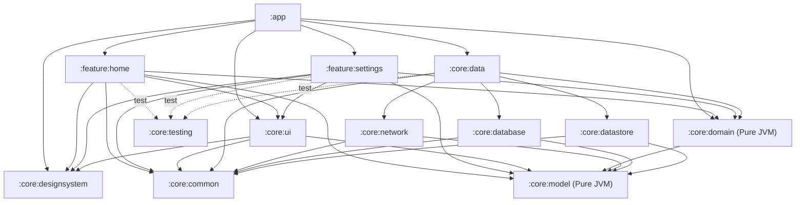
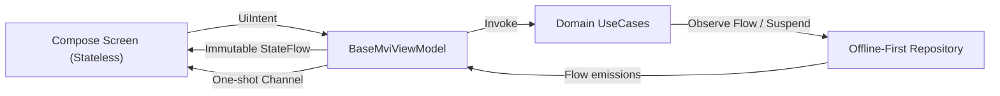

# KuchBhi — Enterprise Android Application

An enterprise-grade Android application built with **Kotlin**, **Jetpack Compose**, **MVI (Unidirectional Data Flow)**, and a **Now in Android–style Feature + Core multi-module architecture** targeting **Android 15 (API 35+)**.

---

## Key Highlights

- **Multi-Module Architecture (`:app`, `:core:*`, `:feature:*`, `:build-logic`)**: Strictly enforced dependency boundaries for parallel Gradle builds, team ownership, and zero circular dependencies.
- **Jetpack Compose + MVI (UDF)**: Immutable `UiState`, explicit `UiIntent` actions, and lifecycle-safe one-shot `UiEffect` events via `BaseMviViewModel`.
- **Offline-First Single Source of Truth**: Room database + Preferences DataStore drive the UI reactively via Kotlin `Flow`; Retrofit/OkHttp + Kotlinx Serialization synchronize remote data into local storage.
- **Enterprise Build System**: Centralized Gradle Version Catalog (`gradle/libs.versions.toml`) + reusable Kotlin DSL convention plugins (`build-logic`).
- **Multi-Environment Flavors**: `dev`, `staging`, and `prod` flavors with isolated Application IDs, environment-specific API endpoints, network security configs, and R8/ProGuard optimization.
- **Quality Gates & CI/CD**: Automated `ktlint`, `Detekt`, Android Lint, JVM/Android unit tests, and APK/AAB builds via GitHub Actions.
- **Architecture Governance**: Full Architecture Decision Records (`docs/adr/`), `CODEOWNERS`, Dependabot, PR/Issue templates, and `CONTRIBUTING.md`.

---

## Project Metadata

| Property | Value |
| --- | --- |
| **Project Name** | `KuchBhi` |
| **Application ID / Base Package** | `com.kuchBhi.com` |
| **Min SDK / Target SDK / Compile SDK** | `35` / `35` / `35` (Android 15+) |
| **Language & Toolchain** | Kotlin `2.0.21`, Java `17`, AGP `8.7.2`, Gradle `8.10.2` |
| **UI & Presentation** | Jetpack Compose (Material 3) + MVI |
| **DI & Async** | Hilt (`2.52`) + Coroutines & Flow |
| **Networking & Storage** | Retrofit + OkHttp + Kotlinx Serialization, Room, DataStore |

---

## Module Dependency Graph



> **Dependency Inversion Rule:** `:feature:*` modules depend **only** on `:core:domain` interfaces and `:core:model` — never on `:core:data`, `:core:network`, `:core:database`, or `:core:datastore`. Concrete implementations are bound in `:core:data` and wired by Hilt in `:app`.

---

## MVI Unidirectional Data Flow



---

## Repository Folder Structure

```text
KuchBhi/
├── .github/
│   ├── ISSUE_TEMPLATE/
│   │   ├── bug_report.md
│   │   └── feature_request.md
│   ├── workflows/
│   │   ├── ci.yml                      # ktlint, Detekt, Unit Tests, Lint, Dev APK
│   │   └── release.yml                 # Tag/manual Release AAB build
│   ├── CODEOWNERS
│   ├── PULL_REQUEST_TEMPLATE.md
│   └── dependabot.yml
├── app/                                # Entry point, Hilt wiring, NavHost, Flavors, R8
│   ├── proguard-rules.pro
│   ├── build.gradle.kts
│   └── src/
│       ├── main/                       # KuchBhiApplication, MainActivity, NavHost, AppConfigModule
│       ├── dev/                        # Dev flavor app name & debug network security config
│       └── staging/                    # Staging flavor app name
├── build-logic/                        # Composite build with reusable Gradle convention plugins
│   ├── settings.gradle.kts
│   └── convention/
│       ├── build.gradle.kts
│       └── src/main/kotlin/com/kuchBhi/com/buildlogic/
│           ├── AndroidApplicationConventionPlugin.kt
│           ├── AndroidApplicationComposeConventionPlugin.kt
│           ├── AndroidApplicationFlavorsConventionPlugin.kt
│           ├── AndroidLibraryConventionPlugin.kt
│           ├── AndroidLibraryComposeConventionPlugin.kt
│           ├── AndroidFeatureConventionPlugin.kt
│           ├── AndroidHiltConventionPlugin.kt
│           ├── AndroidRoomConventionPlugin.kt
│           ├── JvmLibraryConventionPlugin.kt
│           ├── KuchBhiFlavor.kt
│           ├── AndroidCompose.kt
│           ├── KotlinAndroid.kt
│           └── ProjectExtensions.kt
├── config/
│   ├── detekt/detekt.yml               # Static analysis rules
│   └── lint/lint.xml                   # Android Lint security & correctness rules
├── core/
│   ├── common/                         # Coroutine dispatchers, ApplicationScope, DI qualifiers
│   ├── data/                           # Offline-first repositories, DTO/Entity mappers, Hilt bindings
│   ├── database/                       # Room database, Entities, DAOs, exported schemas/
│   ├── datastore/                      # Preferences DataStore for user settings
│   ├── designsystem/                   # Material 3 Theme, Typography, Shapes, reusable components
│   ├── domain/                         # Pure Kotlin JVM: Repository contracts & UseCases
│   ├── model/                          # Pure Kotlin JVM: Domain models & AppResult wrapper
│   ├── network/                        # Retrofit API service, OkHttp, Kotlinx Serialization DTOs
│   ├── testing/                        # MainDispatcherRule & reusable Fake repositories
│   └── ui/                             # BaseMviViewModel, ObserveAsEvents, shared Empty/Error states
├── docs/
│   ├── architecture.md                 # Deep-dive architecture guide
│   ├── modularization.md               # Module catalog & guide to creating new features
│   └── adr/                            # Architecture Decision Records (0001–0004)
├── feature/
│   ├── home/                           # Reference MVI feature: Feed, bookmarks, refresh + unit tests
│   └── settings/                       # Reference MVI feature: Theme, dynamic color, analytics + unit tests
├── gradle/
│   ├── libs.versions.toml              # Centralized Version Catalog
│   └── wrapper/gradle-wrapper.properties
├── .editorconfig
├── .gitignore
├── build.gradle.kts
├── settings.gradle.kts
├── gradle.properties
├── CHANGELOG.md
├── CONTRIBUTING.md
├── LICENSE
├── SECURITY.md
└── README.md
```

---

## Build Flavors & Environments

| Flavor | Application ID (Debug) | Application ID (Release) | App Name | Base API URL |
| --- | --- | --- | --- | --- |
| `dev` | `com.kuchBhi.com.dev.debug` | `com.kuchBhi.com.dev` | `KuchBhi Dev` | `https://dev-api.kuchbhi.example.com/v1/` |
| `staging` | `com.kuchBhi.com.staging.debug` | `com.kuchBhi.com.staging` | `KuchBhi Staging` | `https://staging-api.kuchbhi.example.com/v1/` |
| `prod` | `com.kuchBhi.com.debug` | `com.kuchBhi.com` | `KuchBhi` | `https://api.kuchbhi.example.com/v1/` |

> **Flavor Propagation Avoidance:** Flavors are declared **only** in `:app`. Environment values (`API_BASE_URL`, `DEBUG`) are injected into `:core:network` via Hilt qualifiers (`@ApiBaseUrl`, `@IsDebugBuild`), keeping library modules flavor-agnostic for faster builds.

---

## Getting Started

### Prerequisites

- **Android Studio** Ladybug (2024.2.1) or newer
- **JDK 17** (bundled with Android Studio)
- **Android SDK 35** (Android 15)

### Setup

1. Clone the repository:
   ```bash
   git clone https://github.com/restfulresonance85-cyber/kuchBhi.git
   cd kuchBhi
   ```
2. Open the project in **Android Studio** (or generate the local Gradle wrapper scripts if running from CLI):
   ```bash
   gradle wrapper --gradle-version 8.10.2
   ```
3. Sync Gradle and select the **`devDebug`** build variant in Android Studio's *Build Variants* panel.
4. Run `:app` on an Android 15 (API 35+) device or emulator.

---

## Common Gradle Commands

```bash
# Format & static analysis
./gradlew ktlintFormat
./gradlew ktlintCheck detekt

# Run all unit tests (JVM + Android local tests)
./gradlew testDevDebugUnitTest :core:model:test :core:domain:test

# Run Android Lint
./gradlew :app:lintDevDebug

# Build debug APKs by flavor
./gradlew :app:assembleDevDebug
./gradlew :app:assembleStagingDebug

# Build production Release Android App Bundle (R8 enabled)
./gradlew :app:bundleProdRelease
```

---

## Documentation & ADRs

- [Architecture Guide](docs/architecture.md)
- [Modularization & Adding a New Feature](docs/modularization.md)
- [Architecture Decision Records (ADRs)](docs/adr/README.md)
- [Contributing Guidelines](CONTRIBUTING.md)
- [Security Policy](SECURITY.md)

---

## License

Licensed under the [MIT License](LICENSE).
